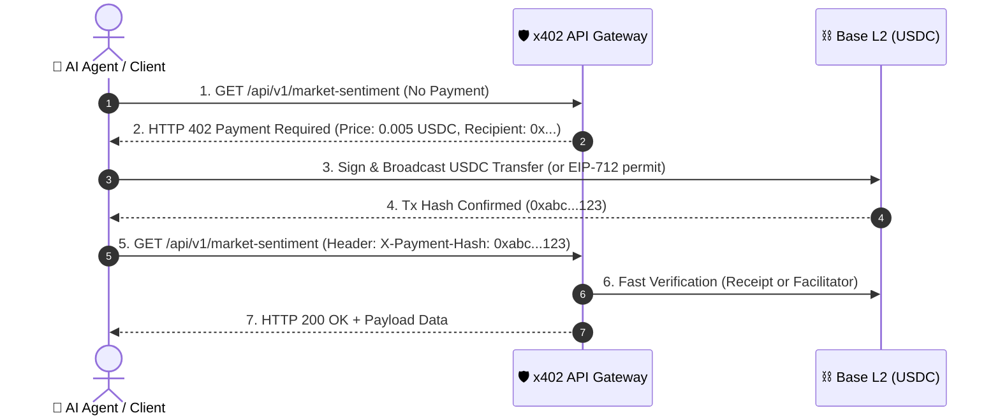

# 🌐 x402 Nexus — AI Agent API Marketplace

> **A full-stack blockchain application leveraging the x402 protocol to enable autonomous AI agent micropayments for pay-per-call API access using USDC on Base L2.**

---

## ⚡ What is x402 Nexus?

The **x402 protocol** revives the dormant HTTP status code **`402 Payment Required`**, enabling instantaneous machine-to-machine micropayments. 

Traditional APIs require credit cards, monthly subscriptions, and pre-funded accounts — bottlenecks that break autonomous AI agents. **x402 Nexus** is a decentralized marketplace where:
- **API Providers** monetize their models, data feeds, and specialized tooling on a per-request basis with zero credit card fees.
- **Autonomous AI Agents & Developers** pay micro-cents per call ($0.001 - $0.05) using **USDC on Base**, automatically settling payments in HTTP headers without upfront subscriptions.

---

## 🚀 Key Features

| Feature | Description |
|---|---|
| 💳 **Interactive x402 Simulator** | Test real HTTP 402 handshake flows step-by-step: `Request` ➔ `402 Payment Required` ➔ `USDC Micropayment` ➔ `Verify & 200 OK`. |
| 📊 **Real-Time Transaction Feed** | Live on-chain & simulated payment feed streaming verified micro-transactions on Base Sepolia. |
| 🛠️ **Auto-Generated SDK Code** | Instant client code (`@x402/fetch`) and server middleware (`@x402/express` / Next.js) for every listed API. |
| 🏷️ **Categorized Marketplace** | Explore APIs across AI Inference, Web Search, Knowledge Graph, Financial Data, and Agent Tooling. |
| 🦊 **Web3 Wallet Integration** | Connect Coinbase Wallet, MetaMask, or any EVM wallet on Base / Base Sepolia testnet. |
| 📡 **Real Next.js 402 API Endpoints** | Production-grade API route handlers that respond with real `402 Payment Required` and RFC-compliant payment headers. |

---

## 🔄 How the x402 Protocol Flow Works



---

## 📦 Tech Stack

- **Framework**: [Next.js 15 (App Router)](https://nextjs.org/)
- **Language**: TypeScript
- **Styling**: Vanilla CSS (Tailored dark mode, cyber-glassmorphism tokens)
- **Blockchain**: Base (Coinbase L2), USDC (ERC-20), EIP-712 micropayment permits
- **Icons**: Lucide Icons
- **Animation**: CSS Keyframes & hardware-accelerated transitions

---

## 🛠️ Getting Started

### Prerequisites

- Node.js 18+ installed
- npm or yarn or pnpm

### Installation

```bash
# Clone the repository
git clone https://github.com/CSE-ShreyashJaiswal/Blockchain_x402-agent-marketplace.git
cd Blockchain_x402-agent-marketplace

# Install dependencies
npm install

# Start the development server
npm run dev
```

Visit [http://localhost:3000](http://localhost:3000) to view the marketplace.

---

## 🧪 Testing the Live 402 Endpoints

You can test the actual HTTP 402 status code response using `curl`:

```bash
# 1. Request endpoint without payment header:
curl -i http://localhost:3000/api/v1/market-sentiment

# Output:
# HTTP/1.1 402 Payment Required
# Content-Type: application/json
# X-Payment-Address: 0x4020000000000000000000000000000000000402
# X-Payment-Amount: 0.005
# X-Payment-Currency: USDC
# X-Payment-Network: base-sepolia

# 2. Request with simulated payment proof header:
curl -i -H "X-Payment-Hash: 0x9f83ab4e2c1a8d0e7f6b5c4a3b2e1d0f9a8b7c6d5e4f3a2b1c0d9e8f7a6b5c4d" \
  http://localhost:3000/api/v1/market-sentiment

# Output:
# HTTP/1.1 200 OK
# Content-Type: application/json
```

---

## 📜 License

MIT License. Built for the Decentralized Web & Autonomous AI Economy.
